# Evidências do Projeto

# ♿ CitizenTech · Acessibilidade Urbana ♿ 

## 🌐 Global Solution 2026.2 · FIAP 🌐
## 💻 Engenharia de Software · C# Software Development 💻

### 👥 Integrantes
| Nome | RM |
|---|---|
| André Luiz Fernandes de Queiroz | 554503 |
| Marcos Vinicius da Silva Costa | 555490 |
| Paulo Poças | 556080 |
| Rafael Bocchi | 557603 |
| Rafael Federici de Oliveira | 554736 |

Este documento reúne as evidências de funcionamento do projeto (testes, app Windows Forms, API REST, banco de dados e integração com o modelo de IA & ML) e explica o que cada uma mostra e o que comprova.

## Ambiente de execução

| Item | Detalhe |
|---|---|
| IDE | Visual Studio (Windows) |
| Plataforma | .NET 8 · C# |
| API | ASP.NET Core Web API (Kestrel) com Swagger, em `http://localhost:5000` |
| Banco | SQLite (`citizentech.db`), acessado pelo EF Core e visualizado no DBeaver |
| Aplicação desktop | Windows Forms, com os mesmos serviços e o mesmo banco da API |
| Dados do ML | `previsoes_escolas_oof.csv` (180.540 escolas), gerado pelo notebook de IA & ML |

## Resumo das evidências

| # | Evidência | Onde | Arquivo(s) |
|---|---|---|---|
| E01 | 57 testes unitários aprovados | Visual Studio – Gerenciador de Testes | 01-testes-aprovados.png |
| E02 | Importação das previsões do ML | App Windows Forms – aba Risco regional (ML) | 02-app-importacao-ml.png |
| E03 | Resumo do risco por região e por UF | App Windows Forms – aba Risco regional (ML) | 03-app-risco-regional.png |
| E04 | Validação de formulário com mensagem amigável | Aba Estabelecimentos | 04-app-validacao.png |
| E05 | Cadastro de uma escola (com código INEP) | Aba Estabelecimentos | 05-app-estabelecimentos-escola.png |
| E06 | Cadastro de um comércio (sem código INEP) | Aba Estabelecimentos | 06-app-estabelecimentos-comercio.png |
| E07 | Diagnóstico de uma escola (com previsão do ML) | Aba Avaliação e diagnóstico | 07-app-diagnostico-escola.png |
| E08 | Diagnóstico de um comércio (sem previsão do ML) | Aba Avaliação e diagnóstico | 08-app-diagnostico-comercio.png |
| E09 | Encaminhamento criado | Aba Avaliação e diagnóstico | 09-app-encaminhamento-criado.png |
| E10 | Lista e acompanhamento dos encaminhamentos | Aba Encaminhamentos | 10-app-encaminhamentos.png |
| E11 | Regra de negócio: transição de status inválida | Aba Encaminhamentos | 11-app-transicao-invalida.png |
| E12 | Consulta de uma avaliação | Swagger – GET /api/avaliacoes/{id} | 12a-swagger-avaliacoes.png, 12b-swagger-avaliacoes.png, 12c-swagger-avaliacoes.png |
| E13 | Listagem de estabelecimentos com filtros e paginação | Swagger – GET /api/estabelecimentos | 13a-swagger-estabelecimentos.png, 13b-swagger-estabelecimentos.png, 13c-swagger-estabelecimentos.png |
| E14 | Diagnóstico completo retornado pela API | Swagger – GET /api/diagnosticos/{id} | 14a-swagger-diagnostico.png, 14b-swagger-diagnostico.png, 14c-swagger-diagnostico.png |
| E15 | Visão geral dos endpoints | Swagger – página inicial | 15a-swagger-visao-geral.png, 15b-swagger-visao-geral.png |
| E16 | Tabelas criadas pelo EF Core | DBeaver – conexão citizentech.db | 16-banco-tabelas.png |
| E17 | Parceiros de exemplo gravados no banco | DBeaver – SELECT * FROM Parceiros | 17-banco-parceiros.png |
| E18 | Previsões do ML gravadas no banco | DBeaver – SELECT COUNT(*) FROM PrevisoesRisco | 18-banco-previsoes.png |

## 1. Testes automatizados

Execução dos testes unitários da solução no Visual Studio.

### E01 - 57 testes unitários aprovados

**Onde:** Visual Studio – Gerenciador de Testes

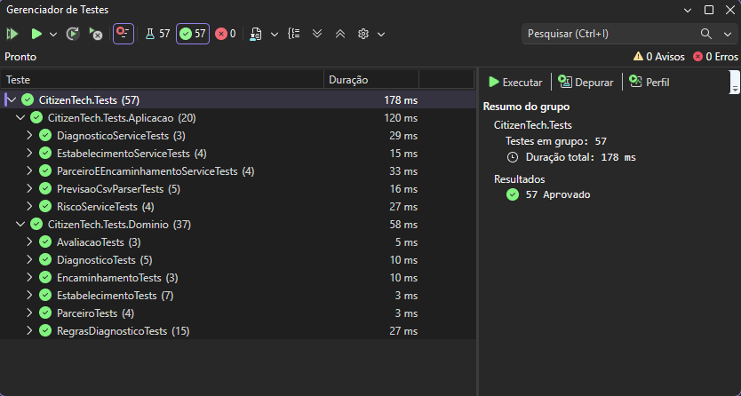

*01 - Gerenciador de Testes: 57 de 57 testes aprovados, 0 falhas.*

**O que mostra:**

- 57 testes executados, **57 aprovados** e **0 falhas**, em 178 ms no total; 0 avisos e 0 erros.
- Grupo **CitizenTech.Tests.Dominio (37 testes)**: AvaliacaoTests (3), DiagnosticoTests (5), EncaminhamentoTests (3), EstabelecimentoTests (7), ParceiroTests (4) e RegrasDiagnosticoTests (15).
- Grupo **CitizenTech.Tests.Aplicacao (20 testes)**: DiagnosticoServiceTests (3), EstabelecimentoServiceTests (4), ParceiroEEncaminhamentoServiceTests (4), PrevisaoCsvParserTests (5) e RiscoServiceTests (4).

**O que comprova:** As regras de negócio (entidades, regras de diagnóstico, serviços e leitura do CSV do modelo de ML) são verificadas automaticamente e estão corretas. Evidencia POO e qualidade de código.

## 2. Integração com o modelo de IA & Machine Learning

O app importa o CSV de previsões gerado pelo notebook de ML (probabilidade de a escola não ter rampa) e agrega os resultados.

### E02 - Importação das previsões do ML

**Onde:** App Windows Forms – aba Risco regional (ML)

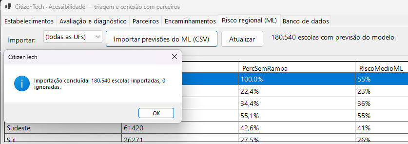

*02 - Mensagem de conclusão da importação do CSV do modelo de ML.*

**O que mostra:**

- Janela de confirmação: **“Importação concluída: 180.540 escolas importadas, 0 ignoradas.”**
- Ao lado do botão de importação, o rótulo **“180.540 escolas com previsão do modelo.”**

**O que comprova:** O app lê o arquivo gerado pela entrega de IA & ML e grava as 180.540 previsões no banco, sem nenhuma linha inválida.

### E03 - Resumo do risco por região e por UF

**Onde:** App Windows Forms – aba Risco regional (ML)

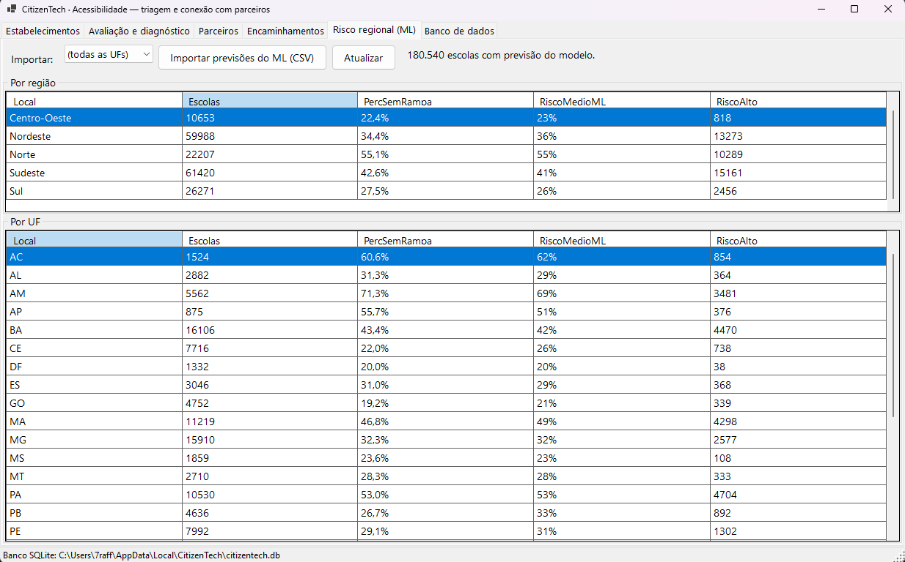

*03 - Grades “Por região” e “Por UF” preenchidas após a importação.*

**O que mostra:**

- Grade **Por região**: Centro-Oeste (10.653 escolas; 22,4% sem rampa declarada; risco médio do ML 23%; 818 de risco alto), Nordeste (59.988; 34,4%; 36%; 13.273), Norte (22.207; 55,1%; 55%; 10.289), Sudeste (61.420; 42,6%; 41%; 15.161) e Sul (26.271; 27,5%; 26%; 2.456).
- Grade **Por UF**, por exemplo: AM com 71,3% de escolas sem rampa (risco médio do ML 69%), AC 60,6%, PA 53,0%, GO 19,2% e DF 20,0%.
- Barra de status com o caminho do banco SQLite em uso.

**O que comprova:** As agregações (GROUP BY com contagem e média, feitas com LINQ/EF Core) funcionam sobre as 180.540 previsões. Os números coincidem com os do notebook de ML (Norte 55,1% e Centro-Oeste 22,4% sem rampa), mostrando que as duas entregas estão integradas.

> **Observação:** A grade “Por região” tem rolagem: na imagem E02 ela aparece rolada ao topo e mostra uma linha extra sem nome (1 escola). No arquivo-fonte do INEP, a escola de código 43145833 vem **sem a região preenchida**; por isso a soma das 5 regiões é 180.539, e não 180.540.

## 3. Aplicação Windows Forms

Telas do app, que usa os mesmos serviços, regras e banco da API.

### E04 - Validação de formulário com mensagem amigável

**Onde:** Aba Estabelecimentos

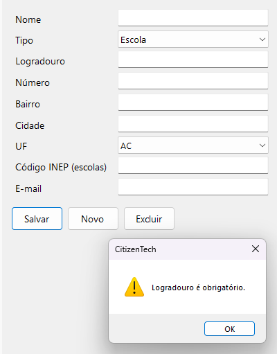

*04 - Aviso exibido ao salvar com o formulário vazio.*

**O que mostra:**

- Formulário em branco e, após clicar em **Salvar**, uma caixa de aviso: **“Logradouro é obrigatório.”**

**O que comprova:** As regras de domínio impedem dados inválidos e o app trata o erro sem travar, mostrando mensagem clara ao usuário.

### E05 - Cadastro de uma escola (com código INEP)

**Onde:** Aba Estabelecimentos

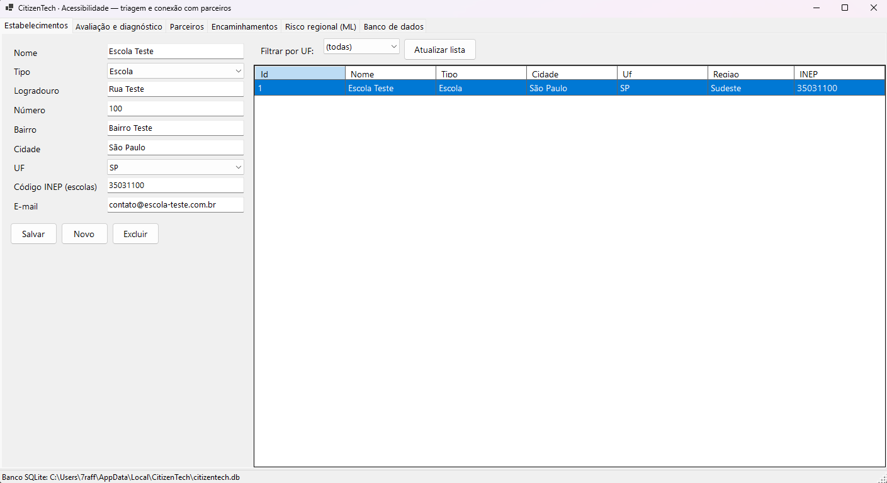

*05 - Formulário preenchido e escola listada na grade.*

**O que mostra:**

- Escola Teste (tipo Escola), Rua Teste 100, São Paulo/SP, **código INEP 35031100**, e-mail de contato.
- Na grade: Id 1, tipo Escola, cidade São Paulo, UF SP, **Região Sudeste** (calculada automaticamente a partir da UF) e INEP 35031100.

**O que comprova:** O cadastro persiste no banco e a região é derivada da UF. O código INEP é o elo com a previsão do modelo de ML.

### E06 - Cadastro de um comércio (sem código INEP)

**Onde:** Aba Estabelecimentos

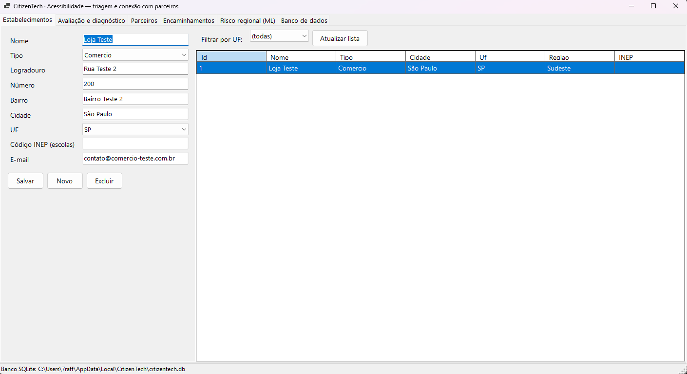

*06 - Comércio cadastrado, com a coluna INEP vazia.*

**O que mostra:**

- Loja Teste (tipo Comercio), Rua Teste 2 200, São Paulo/SP, sem código INEP. Região Sudeste na grade, coluna INEP vazia.

**O que comprova:** A plataforma atende estabelecimentos de vários tipos, não só escolas (o código INEP é opcional).

### E07 - Diagnóstico de uma escola (com previsão do ML)

**Onde:** Aba Avaliação e diagnóstico

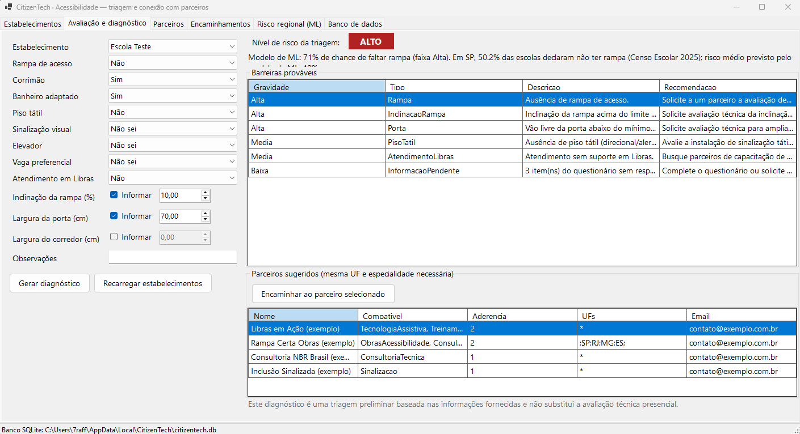

*07 - Triagem gerada para a Escola Teste.*

**O que mostra:**

- **Respostas:** Rampa Não; Corrimão Sim; Banheiro adaptado Sim; Piso tátil Não; Atendimento em Libras Não; Sinalização visual, Elevador e Vaga preferencial “Não sei”. **Medições informadas:** inclinação da rampa 10,00% e largura da porta 70,00 cm (corredor não informado).
- **Nível de risco: ALTO** (selo vermelho, também em texto).
- Linha do modelo: **71% de chance de faltar rampa (faixa Alta)** e contexto de SP (50,2% das escolas sem rampa no Censo Escolar 2025).
- **6 barreiras prováveis:** Rampa (Alta), Inclinação da rampa (Alta), Porta (Alta), Piso tátil (Média), Atendimento em Libras (Média) e Informação pendente (Baixa, 3 itens sem resposta).
- **Parceiros sugeridos** para SP, por aderência: Libras em Ação (2), Rampa Certa Obras (2), Consultoria NBR Brasil (1) e Inclusão Sinalizada (1). Parceiros de outras regiões não aparecem.
- Aviso de que é uma triagem preliminar e não substitui a avaliação técnica presencial.

**O que comprova:** Fluxo central do produto: questionário e medições viram um diagnóstico por regras (polimorfismo), enriquecido com o modelo de ML, e a plataforma sugere parceiros da UF com a especialidade necessária, sem executar obras.

### E08 - Diagnóstico de um comércio (sem previsão do ML)

**Onde:** Aba Avaliação e diagnóstico

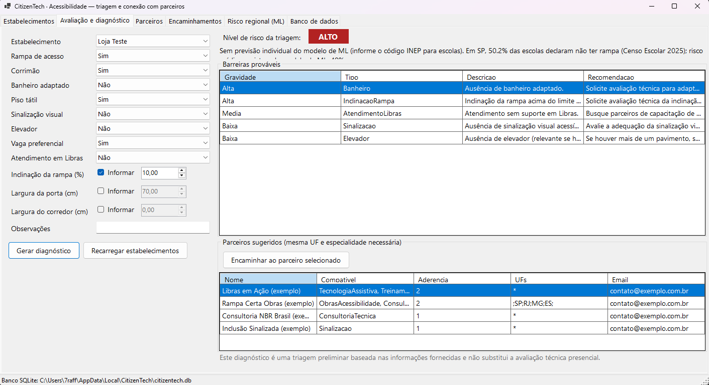

*08 - Triagem gerada para a Loja Teste.*

**O que mostra:**

- **Respostas:** Rampa Sim; Corrimão Sim; Banheiro adaptado Não; Piso tátil Sim; Sinalização visual Não; Elevador Não; Vaga preferencial Sim; Atendimento em Libras Não. **Medição informada:** inclinação da rampa 10,00%.
- **Nível de risco: ALTO.** Mensagem: **“Sem previsão individual do modelo de ML (informe o código INEP para escolas)”**, mantendo o contexto de SP.
- **5 barreiras:** Banheiro (Alta), Inclinação da rampa (Alta), Atendimento em Libras (Média), Sinalização (Baixa) e Elevador (Baixa). Não há “Informação pendente”, pois todos os itens foram respondidos.
- Mesma lista de 4 parceiros sugeridos e mesmo aviso de triagem.

**O que comprova:** O diagnóstico funciona também sem o código INEP (apenas por regras) e as barreiras mudam conforme as respostas e as medições informadas.

### E09 - Encaminhamento criado

**Onde:** Aba Avaliação e diagnóstico

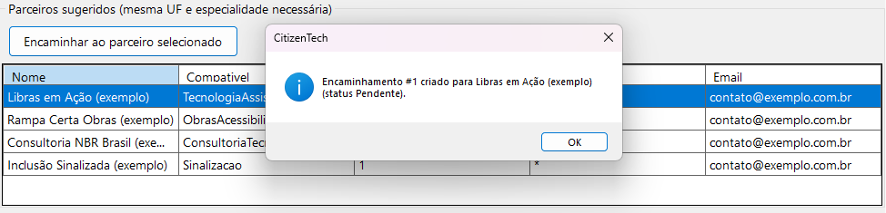

*09 - Mensagem de sucesso ao encaminhar o diagnóstico a um parceiro.*

**O que mostra:**

- Mensagem: **“Encaminhamento #1 criado para Libras em Ação (exemplo) (status Pendente).”**

**O que comprova:** A plataforma conecta o diagnóstico a um parceiro; o encaminhamento nasce com status Pendente.

### E10 - Lista e acompanhamento dos encaminhamentos

**Onde:** Aba Encaminhamentos

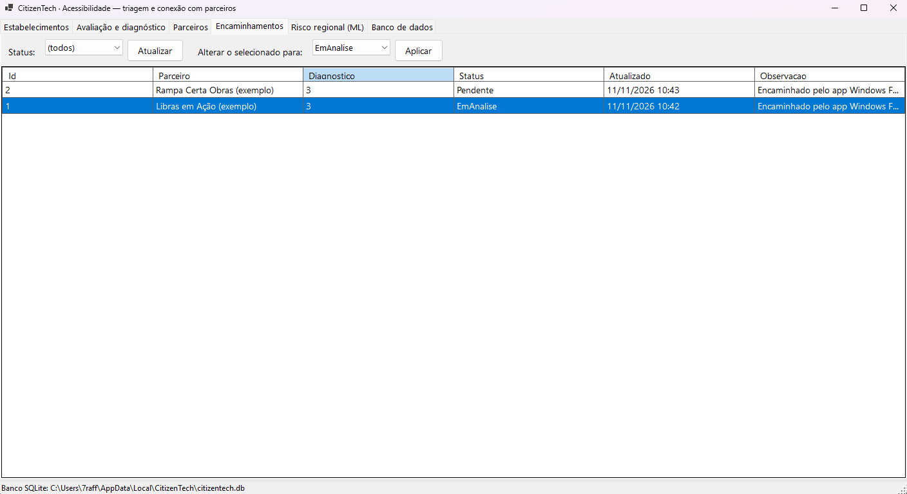

*10 - Lista de encaminhamentos com seus status.*

**O que mostra:**

- Encaminhamento 2: Rampa Certa Obras (exemplo), diagnóstico 3, **Pendente**, atualizado em 11/11/2026 10:43.
- Encaminhamento 1: Libras em Ação (exemplo), diagnóstico 3, **EmAnalise**, atualizado em 11/11/2026 10:42.
- Filtro de status em “(todos)” e controle “Alterar o selecionado para”.

**O que comprova:** Os encaminhamentos ficam registrados e o status evolui pelo fluxo permitido (o encaminhamento 1 já chegou a EmAnalise).

### E11 - Regra de negócio: transição de status inválida

**Onde:** Aba Encaminhamentos

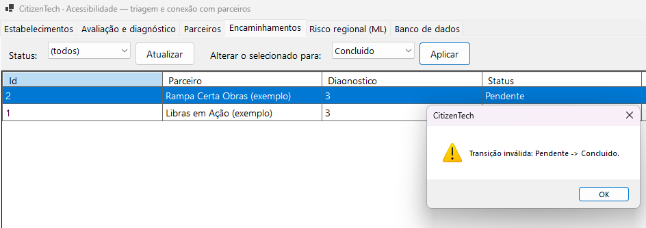

*11 - Tentativa de pular de Pendente para Concluido.*

**O que mostra:**

- Com o encaminhamento 2 (Pendente) selecionado e o novo status “Concluido”, o app exibe: **“Transição inválida: Pendente -> Concluido.”**

**O que comprova:** A máquina de estados do Encaminhamento (Pendente → Enviado → EmAnalise → Concluido; Cancelado antes do fim) é aplicada e protege os dados.

## 4. API REST (Swagger)

Testes feitos pelo Swagger, com a API em execução em http://localhost:5000.

### E12 - Consulta de uma avaliação

**Onde:** Swagger – GET /api/avaliacoes/{id}

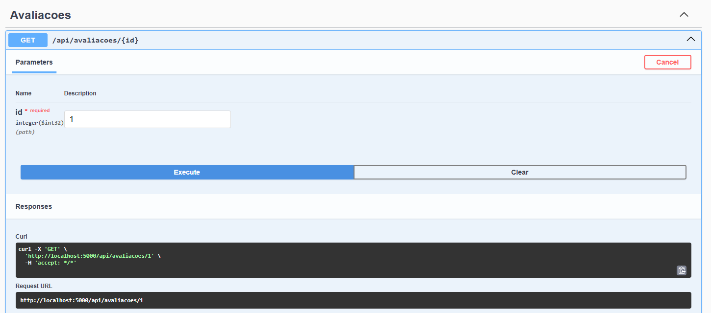

*12A - Requisição com id = 1 (curl e URL gerados pelo Swagger).*

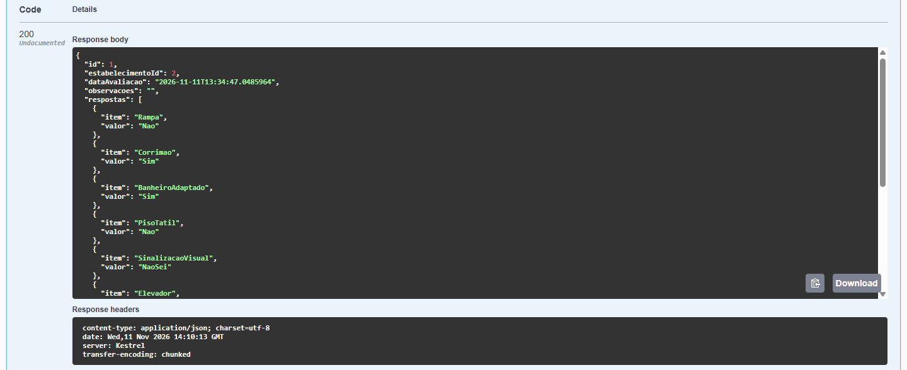

*12B - Resposta HTTP 200 em JSON.*

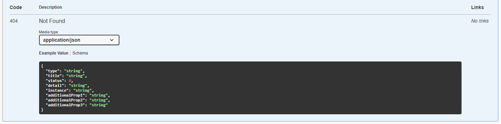

*12C - Modelo documentado da resposta 404 (ProblemDetails).*

**O que mostra:**

- **Requisição:** GET http://localhost:5000/api/avaliacoes/1.
- **Resposta 200** (application/json, servidor Kestrel): avaliação de id 1, do estabelecimento 2, gerada em 11/11/2026, com a lista de respostas (Rampa Nao, Corrimao Sim, BanheiroAdaptado Sim, PisoTatil Nao, SinalizacaoVisual NaoSei, Elevador...).
- A terceira imagem mostra o formato de erro **404 Not Found** documentado pelo Swagger (type, title, status, detail, instance).

**O que comprova:** O endpoint REST responde com dados persistidos, enums como texto legível e erro padronizado documentado (ProblemDetails).

### E13 - Listagem de estabelecimentos com filtros e paginação

**Onde:** Swagger – GET /api/estabelecimentos

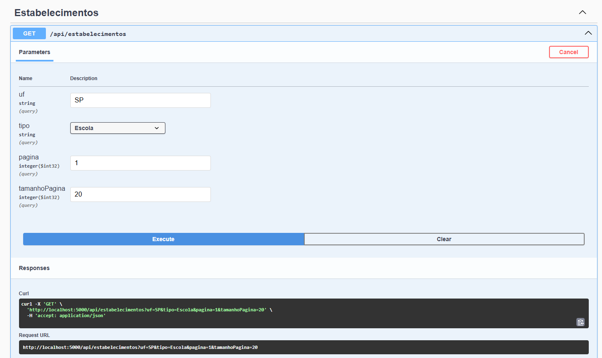

*13A - Parâmetros: uf = SP, tipo = Escola, pagina = 1, tamanhoPagina = 20.*

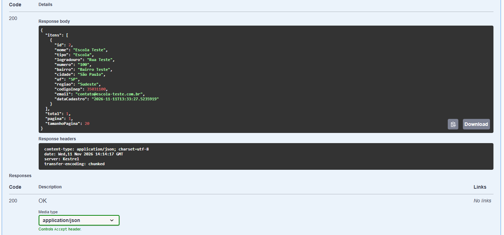

*13B - Resposta HTTP 200 com a página de resultados.*

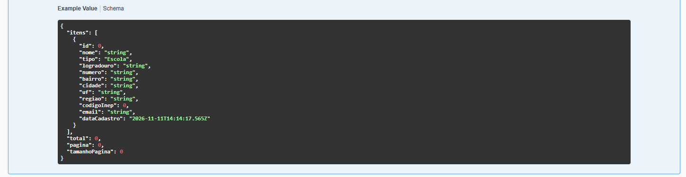

*13C - Modelo (Example Value) da resposta 200.*

**O que mostra:**

- **Requisição:** …/api/estabelecimentos?uf=SP&tipo=Escola&pagina=1&tamanhoPagina=20.
- **Resposta 200:** objeto paginado com 1 item (Escola Teste, id 2, Rua Teste 100, São Paulo/SP, região Sudeste, código INEP 35031100, e-mail e data de cadastro), além de total = 1, pagina = 1 e tamanhoPagina = 20.

**O que comprova:** A API oferece filtros (UF e tipo) e paginação, calculando a região automaticamente.

### E14 - Diagnóstico completo retornado pela API

**Onde:** Swagger – GET /api/diagnosticos/{id}

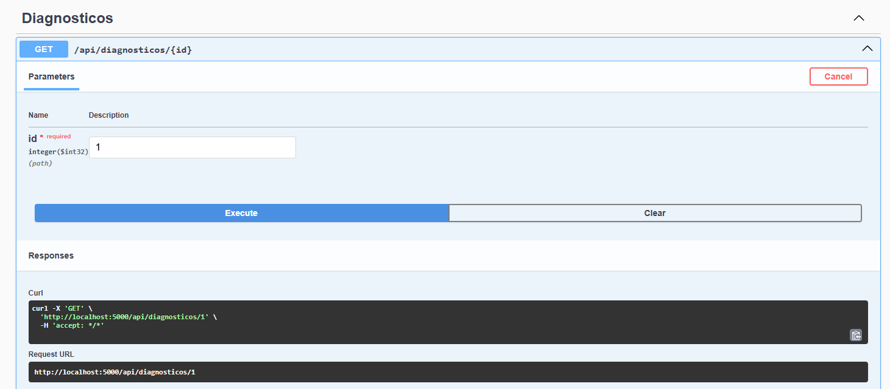

*14A - Requisição com id = 1.*

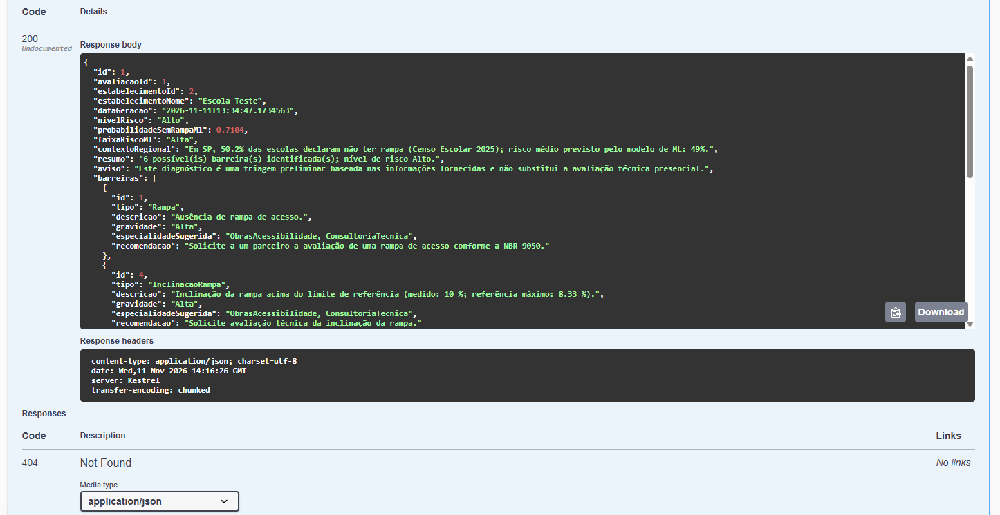

*14B - Resposta HTTP 200 com o diagnóstico.*

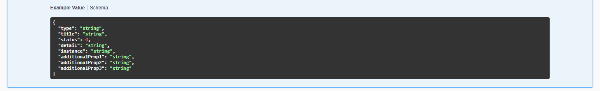

*14C - Modelo documentado da resposta 404.*

**O que mostra:**

- **Resposta 200:** diagnóstico 1 da avaliação 1 (estabelecimento 2, “Escola Teste”), **nivelRisco: “Alto”**, **probabilidadeSemRampaMl: 0.7104**, **faixaRiscoMl: “Alta”**.
- **contextoRegional:** “Em SP, 50.2% das escolas declaram não ter rampa (Censo Escolar 2025); risco médio previsto pelo modelo de ML: 49%.”
- **resumo:** “6 possível(is) barreira(s) identificada(s); nível de risco Alto.” e o **aviso** de triagem preliminar.
- Barreiras com tipo, descrição, gravidade, especialidade sugerida e recomendação, por exemplo: Rampa (Alta; “…conforme a NBR 9050”) e InclinacaoRampa (Alta; “medido: 10 %; referência máximo: 8.33 %”).

**O que comprova:** A API entrega o diagnóstico completo e integrado ao modelo de ML (probabilidade 0,7104, a mesma mostrada no app em E07), com a ressalva de que é triagem.

### E15 - Visão geral dos endpoints

**Onde:** Swagger – página inicial

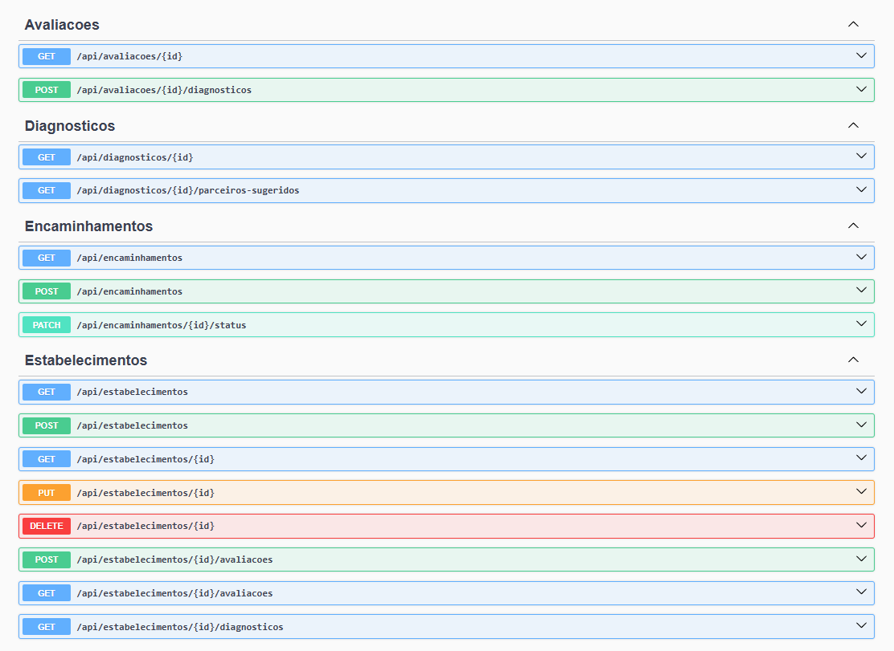

*15A - Grupos Avaliacoes, Diagnosticos, Encaminhamentos e Estabelecimentos.*

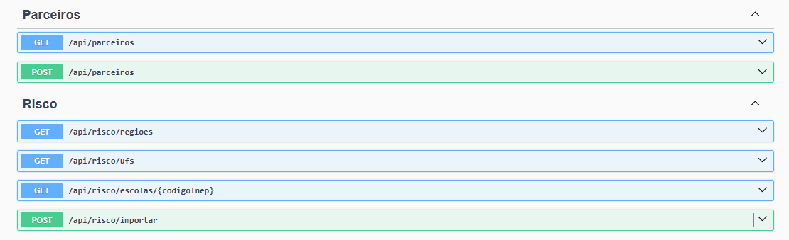

*15B - Grupos Parceiros e Risco.*

**O que mostra:**

- **21 endpoints em 6 grupos:** Avaliacoes (2), Diagnosticos (2), Encaminhamentos (3), Estabelecimentos (8), Parceiros (2) e Risco (4).
- Verbos HTTP corretos: GET, POST, PUT, DELETE e PATCH, em rotas REST como /api/estabelecimentos/{id}/avaliacoes e /api/risco/importar.

**O que comprova:** A API REST completa está publicada e documentada automaticamente pelo Swagger.

## 5. Banco de dados (SQLite no DBeaver)

O mesmo arquivo citizentech.db usado pela API e pelo app, aberto no DBeaver.

### E16 - Tabelas criadas pelo EF Core

**Onde:** DBeaver – conexão citizentech.db

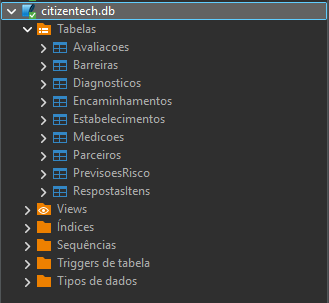

*16 - Árvore do banco com as 9 tabelas.*

**O que mostra:**

- Conexão **citizentech.db** com 9 tabelas: Avaliacoes, Barreiras, Diagnosticos, Encaminhamentos, Estabelecimentos, Medicoes, Parceiros, PrevisoesRisco e RespostasItens.

**O que comprova:** O banco foi criado automaticamente pelo EF Core, com o modelo relacional do projeto, e abre normalmente no DBeaver.

### E17 - Parceiros de exemplo gravados no banco

**Onde:** DBeaver – SELECT * FROM Parceiros

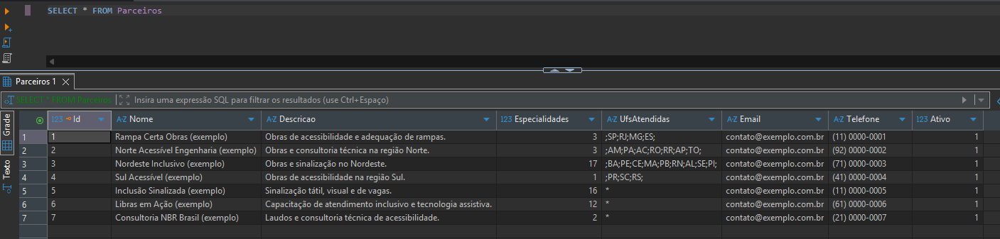

*17 - Resultado da consulta na tabela Parceiros.*

**O que mostra:**

- **7 parceiros** (todos com “(exemplo)” no nome) com colunas Id, Nome, Descricao, Especialidades, UfsAtendidas, Email, Telefone e Ativo (=1).
- As especialidades são guardadas como valor numérico de flags (por exemplo 3 = Obras + Consultoria; 17 = Obras + Sinalização; 12 = Treinamento + Tecnologia assistiva) e as UFs no formato “;SP;RJ;MG;ES;” ou “*” (todo o Brasil).

**O que comprova:** Os dados são persistidos e podem ser consultados por SQL. Os parceiros são fictícios, sem dados pessoais.

### E18 - Previsões do ML gravadas no banco

**Onde:** DBeaver – SELECT COUNT(*) FROM PrevisoesRisco

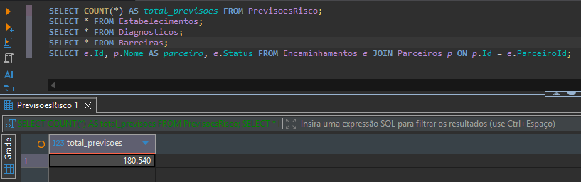

*18 - Script SQL e resultado da contagem de previsões.*

**O que mostra:**

- Script com consultas às tabelas PrevisoesRisco, Estabelecimentos, Diagnosticos, Barreiras e Encaminhamentos.
- Resultado visível da primeira consulta: **total_previsoes = 180.540**.

**O que comprova:** As 180.540 previsões importadas (E02) estão de fato gravadas na tabela PrevisoesRisco.

## Relação com os critérios de avaliação (C# Software Development)

| Critério | Evidências relacionadas |
|---|---|
| POO | E01 (37 testes de domínio, incluindo 15 de regras de diagnóstico), E07 e E08 (regras que geram as barreiras), E11 (máquina de estados do encaminhamento) |
| Web API | E12, E13 e E14 (respostas 200 em JSON, filtros e paginação, modelo de erro 404), E15 (21 endpoints REST) |
| EF Core + LINQ | E16, E17 e E18 (tabelas e dados no banco), E03 (agregações por região e UF), E13 (filtros e paginação) |
| Async/Await | Não é visível em prints; está no código-fonte. Indiretamente: a importação de 180.540 registros (E02) mantém a janela responsiva |
| Qualidade | E01 (57 testes), E04 e E11 (tratamento de erros amigável), E15 (Swagger), E02/E14 (integração com o ML) |
